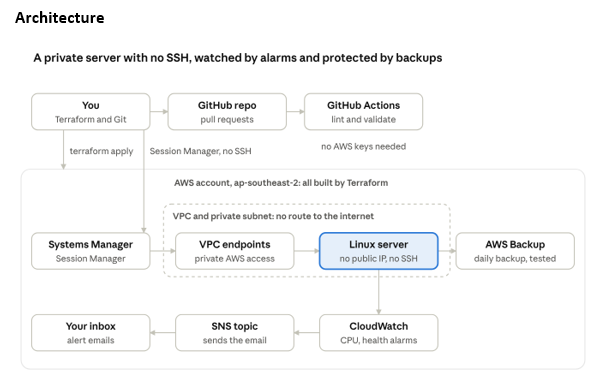

# Secure, Monitored and Recoverable Linux Server on AWS
# Secure, Monitored and Recoverable Linux Server on AWS

A private Linux server on AWS with no public IP and no SSH, managed through Systems Manager Session Manager, monitored with CloudWatch alarms and email alerts, backed up with AWS Backup and a tested restore. Everything is defined in Terraform and checked by GitHub Actions.

This is a foundational build that I made to practise cloud and infrastructure skills.

## What it builds

- A VPC with a private subnet that has no route to the internet
- VPC endpoints so Systems Manager can still reach the server privately
- An Amazon Linux 2023 server (t3.micro) with an encrypted disk and no inbound firewall rules
- Session Manager access instead of SSH (no open port, no key pair)
- CloudWatch alarms for high CPU and failed status checks, with email alerts through SNS
- Daily AWS Backup with a restore I tested and documented
- A Python script that checks the latest backup is recent, and a Bash script that health-checks the server remotely
- A GitHub Actions pipeline that checks every pull request

The whole stack is 25 Terraform resources.

## Architecture



## Repository layout

```text
.github/workflows/checks.yml   CI checks
terraform/                     Network, server, monitoring, backup
scripts/check_backup.py        Checks the newest backup is recent
scripts/health_check.sh        Remote health check through Systems Manager
docs/restore-runbook.md        Restore steps and test results
```

## Prerequisites

- AWS account and an IAM user with admin access (not root)
- AWS CLI v2, Terraform 1.5 or newer, Python 3.12 or newer, Git
- Region: ap-southeast-2 (Sydney)

## Deploy

1. Create `terraform/terraform.tfvars` with your alert address:

   ```hcl
   alert_email = "you@example.com"
   ```

2. Build it:

   ```bash
   cd terraform
   terraform init
   terraform plan
   terraform apply
   ```

3. Confirm the subscription in the email AWS sends, or no alerts will arrive.

## Connect

In the AWS console open EC2, select the server, choose Connect, then the Session Manager tab. Allow 3 to 5 minutes after the first apply for the server to register.

## Test the alerts

```bash
aws cloudwatch set-alarm-state --alarm-name secure-linux-cpu-high \
  --state-value ALARM --state-reason "Manual test of alert path"
```

## Scripts

```bash
python3 -m venv .venv && source .venv/bin/activate
pip install boto3
python3 scripts/check_backup.py --vault secure-linux-vault

./scripts/health_check.sh $(terraform -chdir=terraform output -raw instance_id)
```

## Restore

See [docs/restore-runbook.md](docs/restore-runbook.md). In my test the backup took about 4 minutes and the restore job about 1 minute. A restore always creates a new server from the recovery point, so the runbook also covers cleanup.

## Destroy

If you restored a server in the console, terminate it first, because Terraform does not manage it. Then:

```bash
cd terraform
terraform destroy
```

## Cost

Running it costs roughly US$1 to US$2 per day, mostly for the three VPC interface endpoints. I build it, test it and destroy it the same day.

## What I learned

- A backup you have never restored is only a hope. The restore test showed that restore defaults point at the default VPC, so the subnet, security group, instance profile and role must be set by hand.
- The pipeline caught a deliberate formatting mistake before it reached the main branch.
- Always check output against a second source. My script labelled a local time as UTC until I compared it with the console.

## Next steps

- Add a `terraform plan` job to the pipeline using OIDC, with no stored AWS keys
- Protect the main branch and require the checks to pass
- Add CloudWatch agent memory metrics